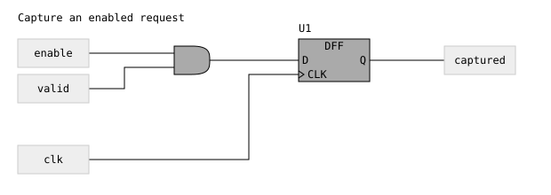
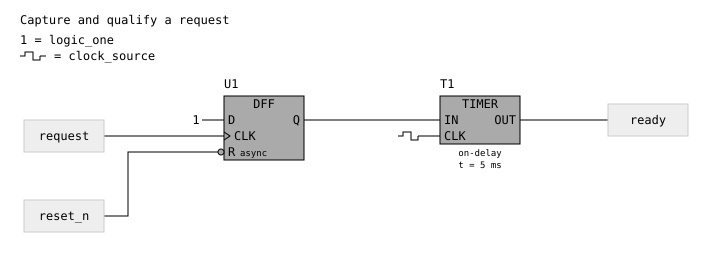

# Connected logic circuits

The `circuit` format draws a single schematic with wires between the gates,
flip-flops, latches, timers, counters, and one-shots. Internal net names remain
available on hover instead of repeating beside every pin. External inputs and
outputs have visible labels.

This is a drawing format. It does not simulate logic, resolve contention,
calculate delays, or prove that a circuit will sequence correctly.

## A complete example

[`test/connected-circuit.json5`](../test/connected-circuit.json5) contains a fully
wired example: `enable` and `valid` feed an AND gate, its output feeds `D` on a
D flip-flop, `clk` feeds the clock pin, and `Q` drives the `captured` output.
The internal `capture_data` name appears in the source and on hover, rather
than as a label between the AND gate and flip-flop.



Render it with the existing command-line interface:

```sh
node bin/cli.js -i test/connected-circuit.json5 > connected-circuit.svg
```

The same source can be passed to `WaveDrom.renderAny` or embedded in a
`<script type="WaveDrom">` element. It uses a root `circuit` object in place of
`assign`, `signal`, or `reg`.

## Compile assignments into a connected layout

The Node API can place and route a mixed `assign` source automatically:

```js
const fs = require('node:fs');
const WaveDrom = require('wavedrom');

async function draw () {
  const source = {
    title: 'Capture an enabled request',
    assign: [
      ['capture_data', ['&', 'enable', 'valid']],
      ['captured', {
        type: 'DFF', id: 'U1',
        inputs: {D: 'capture_data', CLK: 'clk'}
      }]
    ]
  };
  const connected = await WaveDrom.compileCircuit(source);
  const svg = WaveDrom.renderAny(0, connected, WaveDrom.waveSkin);
  fs.writeFileSync('capture.svg', WaveDrom.onml.stringify(svg));
}

draw().catch(error => { console.error(error); process.exitCode = 1; });
```

`compileCircuit` is asynchronous and uses ELK for layout. It creates input
boundaries for referenced nets that have no assignment driver. Unconsumed
assignment outputs become output boundaries by default. To select the visible
outputs, pass `{outputs: [{net: 'captured', label: 'captured'}]}` as the second
argument. The input source is not modified.

Duplicate assignment drivers, unsupported operators, and requested outputs
without a driver are rejected. A missing assignment driver otherwise represents
an external input; it is not evidence that a hardware connection exists.

### Shared constants and clocks

Repeated logic-1 and clock distribution wires can dominate a schematic.
Declare those sources once in `sharedInputs` to show a local `1` or square-wave
terminal at every connected input. Their net names appear once in the legend
and on hover. Reset, enable, and other signal wires retain their explicit paths.

```js
const shared = await WaveDrom.compileCircuit({
  title: 'Capture and qualify a request',
  assign: [
    ['armed', {
      type: 'DFF', id: 'U1',
      inputs: {D: 'logic_one', CLK: 'request', RESET: {net: 'reset_n', active: 'low'}}
    }],
    ['ready', {
      type: 'TIMER', id: 'T1',
      inputs: {IN: 'armed', CLK: 'clock_source'},
      mode: 'on-delay', delay: '5 ms'
    }]
  ]
}, {
  sharedInputs: [
    {net: 'logic_one', symbol: 'one'},
    {net: 'clock_source', symbol: 'clock'}
  ],
  boundaryPlacement: 'near'
});
```



This is an explicit drawing choice: the compiler does not infer that an
unassigned net is a constant or a clock. Every shared source must be used and
must have no ordinary output driver or wire in the same graph. Every input
still has exactly one connection, through a routed edge or a declared shared
source. Supported symbols are `one` and `clock`.

The resulting `circuit.sharedInputs` array preserves those source definitions
for the browser and CLI. Layout reserves a 32-unit left gutter at affected
symbols for the local terminals.

`boundaryPlacement: 'near'` lets boundaries sit near their connections;
the default `'ends'` keeps inputs at the first layer and outputs at the last.
`layoutOrder` optionally lists assignment names or boundary labels in preferred
placement order. Unlisted nodes keep their relative order before listed nodes.
The existing `layoutOptions` object accepts ELK spacing and layout options.

## Graph and coordinates

The renderer consumes a graph with explicit symbol positions and wire routes:

```json5
{
  title: 'Example',
  circuit: {
    width: 620,
    height: 220,
    nodes: [ /* positioned components and their ports */ ],
    edges: [
      {
        id: 'G1-U1',
        net: 'capture_data',
        source: {node: 'G1', port: 'Y'},
        target: {node: 'U1', port: 'D'},
        points: [{x: 252, y: 68}, {x: 320, y: 68}]
      }
    ],
    junctions: []
  }
}
```

All coordinates are SVG units. The origin is the upper-left corner of the
diagram. Each node has an `id`, `type`, `x`, `y`, `width`, `height`, `inputs`,
and `outputs`. Its optional `label` supplies a visible boundary label or
component identifier. A port has an `id`, `name`, `net`, `x`, and `y`; port
coordinates are relative to its node. Edge points are absolute diagram
coordinates, beginning at the source output and ending at the target input.
Segments must be horizontal or vertical.

For example, the AND gate at `(180, 32)` has output `Y` at local `(72, 36)`.
Its wire therefore begins at absolute `(252, 68)`. The DFF at `(320, 24)` has
input `D` at local `(0, 44)`, so the wire ends at `(320, 68)`.

An edge's `net` must match both endpoint ports. Missing nodes or ports,
inconsistent net names, incomplete routes, nonfinite coordinates, and geometry
outside the declared diagram are rejected. Every input must have exactly one
incoming edge, and each net must have one output driver. This validation checks the drawing's
connections and geometry, not the electrical behavior of the circuit.

## Components

| Type | Purpose |
| --- | --- |
| `INPUT`, `OUTPUT` | Labeled diagram boundaries. |
| `AND`, `OR`, `XOR`, `NAND`, `NOR`, `XNOR` | Boolean gates. |
| `NOT`, `BUF` | Inverter and buffer. |
| `DFF`, `DLATCH`, `SRLATCH` | Storage symbols with named pins. |
| `TIMER`, `COUNTER`, `ONESHOT` | Timing and counting function blocks. |

A sequential node also includes `cell`, using the existing
[sequential component fields](sequential-logic.md#component-fields):

```json5
{
  id: 'U1', type: 'DFF',
  x: 320, y: 24, width: 112, height: 76,
  inputs: [
    {id: 'D', name: 'D', net: 'capture_data', x: 0, y: 44},
    {id: 'CLK', name: 'CLK', net: 'clk', x: 0, y: 60}
  ],
  outputs: [{id: 'Q', name: 'Q', net: 'captured', x: 112, y: 44}],
  cell: {type: 'DFF', id: 'U1', inputs: {D: 'capture_data', CLK: 'clk'}}
}
```

Clock triangles, explicit active-low bubbles, complementary outputs, and
asynchronous-control markings keep their existing meaning. Connected symbols
omit the input and output net-name boxes. Timer modes, delays, and initial-state
annotations remain visible; the full component definition is available on
hover.

## Branches and crossings

Use a junction entry `{net, x, y}` to mark an electrical branch with a filled
dot. Crossing wires of different nets have a small gap at the crossing and do
not acquire a junction dot. A geometric crossing alone does not create a connection: the
source and target ports and their shared net identify each connection.

Keep explicit wire paths in the source when exchanging a finished layout.
The browser renderer draws those paths; it does not automatically place nodes
or route wires.

Existing `assign` diagrams retain their separate assignment drawings. Reusing
a net name there does not create a routed wire; use a `circuit` graph for a
connected schematic.
