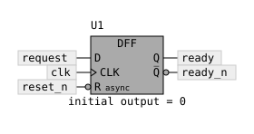

# Sequential logic diagrams

This extension adds flip-flops, latches, timers, counters, and one-shots to
WaveDrom's `assign` diagrams. It draws SVG symbols from the description. It does
not simulate the circuit, calculate timer periods, or generate waveforms.

Upstream `logidrom` 1.2.1 already supports compact `ff` array operators, including
negative-edge, enable, and reset variants. That syntax remains available. This
extension adds the named-port object form below, complementary outputs, latch
symbols, and timer/counter/one-shot function blocks.

For a schematic with actual wires between these symbols and the Boolean gates,
see [Connected logic circuits](connected-circuits.md), including a rendered example
and the automatic Node layout API.

## A first example

Use an object as the second element of an assignment to draw a sequential
component:

```json5
{
  assign: [
    ['ready', {
      type: 'DFF',
      id: 'U1',
      inputs: {
        D: 'request',
        CLK: 'clk',
        RESET: { net: 'reset_n', active: 'low' }
      },
      edge: 'rising',
      output: 'Q',
      complement: 'ready_n',
      initial: 0
    }]
  ]
}
```



Here `ready` is the selected output net. The optional `complement` names a second
output of the opposite polarity. `initial: 0` is an annotation supplied by the
author; it does not initialize or run a model.

Classic combinational assignments keep their existing syntax:

```json5
{
  assign: [
    ['request', ['&', 'enable', 'power_good']],
    ['ready', {
      type: 'DFF',
      inputs: { D: 'request', CLK: 'clk' }
    }]
  ]
}
```

An input must refer to a named net. Nested gate expressions are not accepted
inside a component's `inputs`; give that expression its own classic assignment,
as shown above. The shared net name identifies the intended connection between
the separate assignment drawings. This extension does not route wires between
those drawings.

## Component fields

| Field | Meaning |
| --- | --- |
| `type` | Required component type from the table below. |
| `id` | Optional component identifier printed with the symbol. |
| `inputs` | Required map of port names to named nets. |
| `edge` | `rising` or `falling`; defaults to `rising` for edge-sensitive components. |
| `output` | Selected output polarity; see the component table. |
| `complement` | Optional net name for the opposite-polarity output. |
| `mode` | Timer mode annotation: `on-delay` or `off-delay`. |
| `delay` | Delay or pulse-duration annotation, such as `"10 ms"`. |
| `count` | Count annotation. |
| `divider` | Clock-divider annotation. |
| `initial` | Initial-state annotation. |

The duration and count fields describe the drawing. The renderer does not infer
one field from another, validate physical timing, or evaluate reset priority.

## Components and ports

| Type | Required inputs | Optional inputs | Output choices | Drawing |
| --- | --- | --- | --- | --- |
| `DFF` | `D`, `CLK` | `RESET`, `SET` | `Q` (default), `QN` | D flip-flop with an edge triangle on `CLK`. |
| `DLATCH` | `D`, `EN` | `RESET`, `SET` | `Q` (default), `QN` | Transparent D latch with a level-sensitive enable; no edge triangle. |
| `SRLATCH` | `S`, `R` | `RESET`, `SET` | `Q` (default), `QN` | Set/reset latch; no edge triangle. |
| `TIMER` | `IN` | `RESET`, `EN`, `CLK` | `OUT` (default), `OUTN` | Labeled timer function block. |
| `COUNTER` | `CLK` | `RESET`, `EN`, `LOAD` | `OUT` (default), `OUTN` | Labeled counter function block with an edge-sensitive clock. |
| `ONESHOT` | `IN` | `RESET`, `EN`, `CLK` | `OUT` (default), `OUTN` | Labeled monostable function block with an edge-sensitive trigger. |

Accepted aliases are `D_FF` for `DFF`, `LATCH` or `D_LATCH` for `DLATCH`, and
`SR_LATCH` for `SRLATCH`. Use the canonical port names shown above. `edge` applies
to `DFF.CLK`, `COUNTER.CLK`, or `ONESHOT.IN`; a timer clock does not acquire an
edge marker from a timer mode.

`QN` and `OUTN` select the inverted output and draw an output bubble. When
`complement` is present, its output has the opposite polarity from the selected
output. Thus `output: 'QN', complement: 'q'` names an inverted primary output
and a non-inverted companion output.

`RESET` and `SET` on storage symbols denote direct asynchronous controls. The
renderer does not imply a synchronous reset, a reset/set priority, or behavior
when both controls are asserted. The SR latch's `S` and `R` ports likewise do not
imply a priority rule.

## Input polarity and edge notation

A string is shorthand for an active-high input:

```json5
inputs: { D: 'data', CLK: 'clk' }
```

Use an object to state polarity explicitly:

```json5
inputs: {
  D: 'data',
  CLK: 'clk',
  RESET: { net: 'reset_n', active: 'low' }
}
```

`active` accepts `high` or `low`. A low-active input gets an inversion bubble.
A net name ending in `_n` does not set its polarity automatically. For a D latch,
a low-active `EN` depicts transparency while enable is low.

Use `edge: 'falling'` for a falling-edge clock or trigger. It adds the inversion
bubble before the edge triangle. Prefer a string or `active: 'high'` on that
clock or trigger input so the `edge` field expresses the edge selection once.
`active: 'low'` on `CLK` or the one-shot trigger is rejected; use `edge` instead.
Optional `TIMER.CLK` and `ONESHOT.CLK` are neutral clock-source ports without an
edge triangle or selectable polarity.

`count` must be a nonnegative safe integer, `divider` a positive safe integer,
and `initial` either `0` or `1`. A `delay` is a nonempty single-line string.
Unknown fields and ports are rejected so a misspelling cannot silently change
the drawing's meaning.

## Timers, counters, and one-shots

These use generic rectangular function blocks with labeled inputs and outputs.
A timer has no universally applicable gate outline. Its label and annotations
identify the intended function instead of borrowing a flip-flop symbol.

```json5
{
  assign: [
    ['settled', {
      type: 'TIMER',
      id: 'T1',
      inputs: { IN: 'enable', RESET: 'reset' },
      mode: 'on-delay',
      delay: '10 ms'
    }],
    ['pulse', {
      type: 'ONESHOT',
      id: 'T2',
      inputs: { IN: 'trigger' },
      edge: 'falling',
      delay: '2 ms'
    }]
  ]
}
```

`TIMER` without `mode` makes no on-delay or off-delay assertion. `ONESHOT` does
not specify retriggering behavior; add that information to the surrounding
circuit documentation. `COUNTER` depicts the named clock/control ports and
provided count/divider annotations, not a simulated count sequence or a bus of
individual count bits.

## Layout and compatibility

Set `config.assignColumns` to an integer from 1 to 4 to arrange assignments in
columns. The optional root `title` labels the drawing:

```json5
{
  title: 'Sequential symbol examples',
  config: { assignColumns: 2 },
  assign: [ /* assignments */ ]
}
```

An `assign` source containing only classic array/string expressions continues to
use the upstream renderer unchanged. A source with at least one component object
uses the extended renderer, including for its classic assignments. The complete
generic example is in [`test/sequential-symbols.json5`](../test/sequential-symbols.json5).

## Symbol references

The symbols are original SVG drawings following conventional logic notation:
rectangular storage blocks, edge triangles, and inversion bubbles. They are not
a complete implementation or certification of an IEEE or IEC symbol standard.

- Texas Instruments, [SN74AHC74-EP datasheet](https://www.ti.com/lit/ds/symlink/sn74ahc74-ep.pdf),
  page 2, shows D flip-flop logic symbols with preset/clear and complementary
  outputs. Its symbol note identifies **ANSI/IEEE Std 91-1984** and **IEC
  Publication 617-12** as its references.
- Texas Instruments, [SN74LVC1G74 datasheet](https://www.ti.com/lit/ds/symlink/sn74lvc1g74.pdf),
  page 1, provides a positive-edge D flip-flop example with direct active-low
  preset and clear.
- Texas Instruments, [SN74LVC1G373 datasheet](https://www.ti.com/lit/ds/symlink/sn74lvc1g373.pdf),
  page 1, provides a level-enabled D-latch example. Its output-enable circuitry
  is specific to that device and is not an implied feature of `DLATCH` here.
- Texas Instruments, [SN74LVC1G123 datasheet](https://www.ti.com/lit/ds/symlink/sn74lvc1g123.pdf),
  pages 1 and 6, provides a monostable function block and trigger/output timing
  example. The generic `ONESHOT` symbol does not imply that device's external RC
  network, retriggering, or timing equations.
